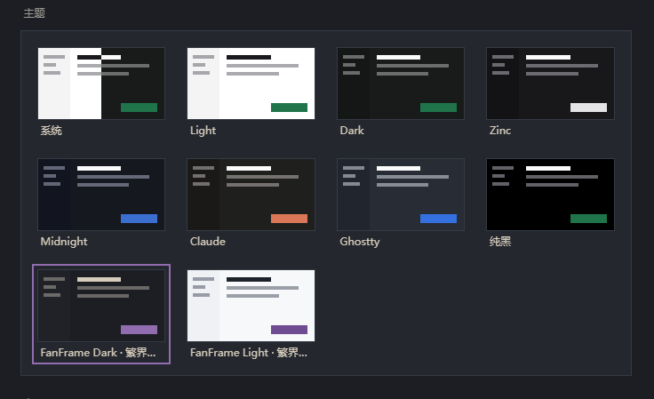

<div align="center">
  
  <h1>繁界 · FanFrame</h1>
  <p><strong>Sharp-cornered gothic-minimal themes &amp; reading/media enhancements for Paseo.</strong></p>
  <p>为 <a href="https://paseo.sh">Paseo</a> 打造的低饱和深浅双色直角主题，兼顾长文阅读层次、紧凑侧栏、AI 提问点选卡片与跨主机媒体播放。</p>

  <p>
    <a href="#preview--效果预览">Preview</a> ·
    <a href="#install--安装">Install</a> ·
    <a href="#features--功能特性">Features</a> ·
    <a href="#interactive-visualizations--内嵌可视化">Visualizations</a> ·
    <a href="#motion--micro-animations--克制动效系统">Motion</a> ·
    <a href="#configuration--配置开关">Configuration</a> ·
    <a href="#data--privacy--数据与权限边界">Privacy</a>
  </p>
</div>

---

## Preview · 效果预览

<p align="center">
  
</p>

<p align="center">
   Appearance" width="76%" />
</p>

---

## Features · 功能特性

### 🎨 Themes & Visual Refinement · 主题与视觉层次
- **FanFrame Dark / FanFrame Light** — Two low-saturation, eye-friendly palettes (`Settings → Appearance`) tailored for long coding and reading sessions.
- **Sharp 0px Geometry & Solid Overlays** — Removes rounded bubbles, translucent blur overlays, and harsh focus outlines in favor of crisp 1px borders and clean color-change focus cues.
- **Low-Saturation Markdown Palette** — Distinct, restrained hues for headings, bold, italic, inline code, quotes, markers, and tables across both dark and light modes.
- **Perceptual 3-Tier Prose Layering** — Uses CSS Custom Highlight API + OKLab equal-step luminance tiers (plus steel-blue brackets and warm-amber numbers) to give dense paragraphs effortless visual rhythm without altering text selection or copy behavior.
- **Restrained Motion** — Subtle micro-transitions for controls, square-orbit running spinners, and smooth expand/collapse feedback that respects `prefers-reduced-motion`.

### 🧭 Sidebar Density · 侧栏布局优化
- **3-Column Top Navigation Grid** — Compresses the top sidebar links (`History`, `Search`, `Schedules`, and plugin items) into a compact 3-column icon-left/text-right grid with automatic ellipsis, cutting header height in half on both desktop and mobile web.
- **Unified 28px Row Cadence** — Aligns project rows, workspace rows, and nav buttons to the same clean 28px height.
- **Project-Matched Title Colors** — Automatically tints project titles to match their letter-badge icon colors for instant visual scanning.

### ⚡ Interaction & Cross-Host Media · 交互与跨主机媒体
- **Interactive Question Cards** — Automatically upgrades plain-text `[1] / [2]` option prompts (e.g. Antigravity over ACP) into clickable multi-step cards with auto-advance, one-tap recommended selection, custom notes, and automatic collapse once answered.
- **Host-Scoped Inline Media & Custom Player** — Renders ` ```fanframe-media ` blocks across **both local and remote hosts**, featuring chunked download progress bars, 2-tier local caching (RAM LRU + persistent IndexedDB with size/mtime validation), layout-preserving loading skeletons, lightbox image zoom, expandable PDF/text previews, and a custom sharp-cornered audio/video player (play/pause, drag scrubber, mute, fullscreen, download).
- **Cross-Device File Transfer (`传文件`)** — Adds a composer `传文件` pill supporting images (auto-compressed to ≤1600px by default, with an original-quality toggle) and arbitrary files up to 50 MiB via chunked upload/download, forwarding native attachments to the active agent and rendering synchronized preview/download cards across desktop and mobile clients.

---

## Interactive Visualizations · 内嵌可视化

FanFrame equips every agent session with the built-in **`fanframe_visualize`** tool so data trends, comparisons, distributions, and interactive calculators render directly inside the conversation instead of walls of numbers:

- **Graphics-First & Zero Friction** — Agents proactively generate clean HTML / SVG / Canvas cards when structured data benefits from visual encoding; cards can be placed inline anywhere in a reply via `[[fanframe-viz:<cardId>]]` or appended cleanly at turn end.
- **Strict Sandbox & Auto-Sizing** — Every card runs inside an isolated `sandbox="allow-scripts"` iframe (`Content-Security-Policy: default-src 'none'`, zero external requests) with automatic height tracking via `ResizeObserver` and `MutationObserver`.
- **Theme-Synced Tokens & Controls** — Automatically injects dark/light palette variables (`--fanframe-viz-series-1` soft amber, `--fanframe-viz-series-2` mist blue, `--fanframe-viz-highlight` teal, surface/border/muted tokens), styled sharp-cornered native controls (`<button>`, `<select>`, `<input type="checkbox">`, and diamond-thumb `<input type="range">` sliders), plus 15 built-in stroke SVG icons (`sun`, `cloud`, `trend-up`, `trend-down`, `calendar`, `clock`, etc.).
- **Smooth Placeholder Loading** — Reserves the card frame with an animated progress sweep while fetching cached card HTML across local or remote hosts.

---

## Motion & Micro-Animations · 克制动效系统

FanFrame replaces abrupt UI snapping with a calm, sharp-edged motion language designed to stay unobtrusive during long sessions:

- **Interactive Micro-Transitions** — 140ms–180ms `cubic-bezier` transitions on background, ink, border, opacity, and icon states across buttons, tabs, switches, menus, and tool-call badges.
- **Fluid Expand & Collapse Disclosures** — Layout-neutral GPU FLIP expand transitions (`180ms`) and single-drawer anchored collapse (`170ms`) keep collapsible AI details and tool panels smooth without scroll jumps, paired with a bottom-only auto-scroll guard that immediately yields when you scroll up during streaming.
- **Square-Perimeter Orbit Spinner** — Transforms rounded spinning borders into a crisp 0px square-orbit conic-gradient progress ring (`900ms`) that fits FanFrame's angular aesthetic, while removing redundant overlapping tab spinners.
- **Animated Loading Sweep Bars** — Pre-sized skeletons for images, audio/video players, documents, and visualization cards carry a 2px accent sweep bar so remote assets settle into place without sudden layout jumps.
- **Reduced-Motion Friendly** — Automatically honors `prefers-reduced-motion: reduce`, disabling orbit and disclosure motion cleanly when requested by the OS.

---

## Install · 安装

Enable plugins first in Paseo (**Settings → Plugins → Enable plugins**), then run:

```bash
paseo plugin install https://github.com/AngleNaris/paseo-fanframe.git
```

Update to the latest version anytime:

```bash
paseo plugin update paseo-fanframe
```

After installation:
1. Open **Settings → Appearance** and select **FanFrame Dark · 繁界深色** or **FanFrame Light · 繁界浅色**.
2. Open **Settings → Plugins → FanFrame** to toggle individual modules.

> **Multi-host tip · 多主机提示**: When using Paseo across a local machine and remote hosts, install/update `paseo-fanframe` on each daemon host whose conversations use inline media previews, cross-device image uploads, or `fanframe_visualize`.

---

## Configuration · 配置开关

Every enhancement can be toggled independently in **Settings → Plugins → FanFrame** and cleans up automatically when turned off:

| Module | Default | Description |
| :--- | :---: | :--- |
| **Sharp Corners & Solid Overlays** | On | 0px corners, opaque popups, non-outline focus, square running spinner |
| **Low-Saturation Markdown Palette** | On | Adaptive dark/light syntax colors for Markdown elements |
| **3-Tier Prose Brightness Layering** | On | Clause-level OKLab luminance rhythm + bracket/number accents |
| **Restrained Micro-Motion** | On | Smooth color & disclosure transitions (`prefers-reduced-motion` aware) |
| **Cross-Device File Pill (`传文件`)** | On | Chunked file & compressed image upload button in the composer track bar |
| **3-Column Sidebar Nav Grid** | On | Compact 3-column grid for top sidebar navigation (desktop & mobile web) |
| **Interactive AI Question Cards** | On | Upgrades `[1] / [2]` text prompts into clickable selection panels |

---

## Media & Visualization Blocks · 内嵌媒体与图表

Agents on any connected host can embed local media inline using a fenced `fanframe-media` (or `dsh-media`) JSON block:

````markdown
```fanframe-media
{"path": "/absolute/path/to/preview.png", "title": "Preview image"}
```
````

Supported formats:
- **Images**: `.png`, `.jpg`, `.jpeg`, `.webp`, `.gif` (up to 24 MiB, click to zoom)
- **Audio**: `.wav`, `.mp3`, `.ogg`, `.m4a`, `.flac` (up to 32–48 MiB, custom sharp player)
- **Video**: `.mp4`, `.webm`, `.mov`, `.m4v` (up to 128 MiB, custom sharp player + fullscreen)
- **Documents**: `.pdf` (up to 32 MiB), `.txt`, `.md`, `.csv`, `.tsv`, `.json` (up to 2 MiB, expandable)

For interactive charts, agents can call the built-in `fanframe_visualize` tool and optionally place `[[fanframe-viz:<cardId>]]` inline in their reply.

---

## Data & Privacy · 数据与权限边界

- **No external network calls or telemetry**: Everything runs locally between your Paseo client and your own connected daemon host(s).
- **Local storage**: Visual toggle states are stored in browser `localStorage`; cross-device uploaded files are stored under `~/.paseo/plugin-data/paseo-fanframe/shared-files/` (plus legacy `shared-images/`, auto-pruned by age and count) and forwarded as image or native file attachments to the selected agent provider.
- **Host file reads (workspace-scoped by default)**: Inline media previews enforce server-side `realpath` containment against the active conversation's workspace directory (`agent.cwd`), bounded by an extension allowlist and per-type size limits. Files outside the active workspace are blocked from automatic inspection/reading unless the user explicitly adds their directory to the per-host allowlist, confirms from the blocked notice card, or enables the opt-in **"Allow all paths"** switch (off by default) under **Settings → Plugins → FanFrame**.
- **Sandboxed visualizations**: All `fanframe_visualize` cards render inside `sandbox="allow-scripts"` iframes with `Content-Security-Policy: default-src 'none'`.

---

## Development · 开发

```bash
npm install
npm run typecheck
paseo plugin install /absolute/path/to/paseo-fanframe
paseo plugin reload paseo-fanframe
```

---

## License

[MIT](./LICENSE) © FanFrame contributors
